# 📦 Awesome Direct-to-Consumer Returns Optimization Stacks 🔄

### *Curated Architecture, SaaS Platforms & Open-Source Reverse Logistics Software*

  
  
  
  
  
  
  

  <b>A comprehensive directory of reverse logistics, Return Merchandise Authorization (RMA) portals, disposition routing, and circular economy recommerce solutions for modern direct-to-consumer (D2C) brands.</b>

---

## 📑 Table of Contents

- [📊 Sector Overview & Market Dynamics](#-sector-overview--market-dynamics)
- [☁️ SaaS & Hosted Platforms](#️-saas--hosted-platforms)
- [💻 Open-Source GitHub Projects](#-open-source-github-projects)
- [🤝 How to Contribute](#-how-to-contribute)
- [💖 Support & Sponsor](#-support--sponsor)
- [📈 Star History](#-star-history)
- [⚠️ Disclaimer](#️-disclaimer)

---

## 📊 Sector Overview & Market Dynamics

The global reverse logistics and returns management market is estimated at approximately **$710B – $980B+ (surpassing $1T by 2026)**, propelled by e-commerce return rates averaging 20–30% in apparel and consumer electronics. The sector is **moderately fragmented**: while a concentrated core of legacy carrier giants (UPS, FedEx, DHL) dominates physical parcel networks, the software and returns-optimization layer remains highly competitive and fragmented across specialized D2C platforms, automated RMA engines, and circular economy recommerce startups.

---

## ☁️ SaaS & Hosted Platforms

| 🚀 Platform | 🏷️ Starting Price | 🎁 Free Tier / Trial Limit | 📈 Scale (Revenue / Valuation) | ⚡ Key Capabilities & Focus |
| :--- | :--- | :--- | :--- | :--- |
| **[Happy Returns](https://happyreturns.com/)** | $500/month (Plus plan starting baseline) | No free trial; custom live demo only | **$465M acquisition valuation** (acquired by UPS from PayPal in 2023; 10x revenue growth) | Operates an extensive network of 2,600+ physical Return Bar locations for box-free, label-free returns and aggregated reverse freight. |
| **[Narvar](https://corp.narvar.com/)** | ~$2,500/month (annual contract ~$30,000/yr starting baseline) | No free trial; enterprise sales demo only | **$315M valuation** (~$57M ARR; $64M total funding) | Enterprise post-purchase experience and multi-carrier returns orchestration for tier-1 global retail brands. |
| **[Returnly](https://returnly.com/)** | $149/month (legacy starter rate prior to sunset) | 14-day free trial (legacy; platform sunset in Oct 2023) | **$300M acquisition valuation** (acquired by Affirm in 2021) | Pioneer of Instant Refunds and customer-facing store credit underwriting integrated with Affirm BNPL. |
| **[Optoro](https://www.optoro.com/)** | ~$1,500/month (enterprise contracts based on return volume) | No free trial; tailored product consultation only | **~$200M+ valuation** ($200M+ funding; acquired by Blue Yonder in Aug 2025; ~$30M–$50M ARR) | Returns management system (RMS) paired with smart disposition routing and recommerce liquidation via BULQ. |
| **[Loop Returns](https://loopreturns.com/)** | $155/month (Essential tier; Advanced at $340/month) | Checkout+ free baseline plan (0 recurring platform fee) & demo evaluations | **~$175M total funding** (~$44M–$53M ARR; backed by Shopify and CRV) | Shopify-native market leader specializing in Shop Now exchanges, instant variant swaps, and revenue retention. |
| **[AfterShip Returns](https://www.aftership.com/returns)** | $9/month (Essentials plan; Pro at $49/month, Premium at $199/month) | 7-day free trial (also offers Return Care shopper-funded free tier) | **$85M ARR** (Series B led by Tiger Global at $66M round; $69M total funding) | Multi-carrier return tracking and self-service RMA with transparent entry-level pricing tiers. |
| **[Sorted](https://www.sorted.com/)** | Usage-based ATU model (starts at ~$1,000/month minimum deployment) | No free trial; scheduled platform demo only | **~$75M peak valuation** ($134M total funding; acquired by Huboo in 2024; £1M–£10M revenue) | Delivery experience orchestration and post-purchase reverse carrier routing for UK and international retailers. |
| **[ZigZag Global](https://www.zigzag.global/)** | $0/month (Free Plan for UK domestic returns; Silver at $20/month) | Free Plan (UK domestic returns) or 14-day free trial on Shopify | **$70M acquisition valuation** (acquired by Global Blue in 2021; $24.5M pre-acquisition funding) | Cross-border international returns routing, paperless QR codes, and local re-dispatch hubs. |
| **[ReturnLogic](https://www.returnlogic.com/)** | $299/month (Standard tier; select app integrations start at $49/month) | No free trial; scheduled demo with returns specialist only | **~$18.8M total funding** (acquired by Redo; estimated ~$2.8M ARR) | Comprehensive returns management workflow platform connecting 3PLs, customer service, and inventory restocking. |
| **[Pollen Returns](https://www.pollenreturns.com/)** | ~$500/month (custom quote based on door-to-hub pickup volume) | No free trial; pilot partner consultation only | **Early-stage venture-backed** ($5M+ funding round targeted) | Doorstep pickup and label-free returns network optimizing last-mile reverse logistics and asset value recovery. |

---

## 💻 Open-Source GitHub Projects

Sorted by GitHub Stars (descending):

- **[n8n](https://github.com/n8n-io/n8n)**   
  ⚡ Fair-code workflow automation platform widely deployed as the orchestration glue between e-commerce checkouts, 3PL reverse logistics webhooks, and ERP RMA statuses. Synchronizes return states, generates tracking notifications, and triggers refund approvals automatically without custom integration code.

- **[Odoo Community Edition](https://github.com/odoo/odoo)**   
  🏬 Comprehensive open-source business suite handling internal transfers, receipts, deliveries, and reverse logistics within warehouse operations. Natively supports customer returns, supplier returns, quality inspection check-loops, and RMA scrap/restock movements.

- **[ERPNext](https://github.com/frappe/erpnext)**   
  📦 100% open-source ERP acting as a system of record for stock returns and RMA lifecycles. Natively supports sales returns, purchase returns, serial/batch tracking, quality inspection gating, and accounting credit memo generation linked directly to original invoices.

- **[Camunda Platform (Community Edition)](https://github.com/camunda/camunda-bpm-platform)**   
  🔀 Open-source BPMN workflow and decision automation engine ideal for modeling complex RMA authorization, grading steps, warranty evaluations, and disposition routing (restock, refurbish, recycle, or scrap) outside of hardcoded ERP rules.

- **[ModernWMS](https://github.com/fjykTec/ModernWMS)**   
  🏭 Modern, lightweight cross-platform warehouse management system designed for SMEs. Provides full receiving, stock movement, inventory allocation, and customer return check-in workflows with support for barcode scanners and mobile PDA devices.

- **[Free WMS (.NET Clean Architecture)](https://github.com/go2ismail/Asp.Net-Core-Inventory-Order-Management-System)**   
  🏗️ Production-grade warehouse inventory and order management system built on .NET 9 Clean Architecture and CQRS/MediatR. Features dedicated **Sales Returns** and **Purchase Returns** modules with complete validation, inventory restock adjustment, and headless REST APIs.

- **[Apache OFBiz](https://github.com/apache/ofbiz-framework)**   
  🏛️ Mature, enterprise-grade open-source ERP and e-business framework featuring comprehensive Return Material Authorization (RMA) tracking, return item status workflows, restocking fee calculations, replacement order generation, and refund processing.

- **[OpenBoxes](https://github.com/openboxes/openboxes)**   
  🏥 Open-source supply chain and inventory management system excelling at handling returned but undecided inventory. Explicitly models quarantine areas, inspection hold states, temporary reverse staging, and disposition tracking.

- **[OpenWMS.org](https://github.com/openwms/org.openwms)**   
  🧩 Modular, microservice-based open-source Warehouse Management System built on Spring Boot. Handles inbound receipt of customer returns, stock identification, transport unit tracking, and warehouse routing for reverse logistics.

- **[iDempiere](https://github.com/idempiere/idempiere)**   
  🛡️ OSGi-based open-source ERP system featuring process-heavy, audit-compliant RMA workflows. Enforces strict authorization, inspection sign-offs, and multi-tier approval paths for returned goods and supplier claims.

- **[OCA Stock Logistics Warehouse (Odoo Addons)](https://github.com/OCA/stock-logistics-warehouse)**   
  🚚 Community-maintained collection of advanced logistics, routing, and returns handling modules for Odoo, extending standard warehouse operations with RMA verification, return packaging, and routing rules.

- **[Tryton](https://github.com/tryton/tryton)**   
  ⚙️ Modular open-source business application platform providing modular logistics logic. Accurately models return shipments, customer credit reconciliation, inventory devaluation, and full movement audit trails.

- **[ShadowOS PDP with Pickup and Delivery](https://github.com/ShadowOS/Vechicle-Routing-Problem-VRP-with-Pickup-and-Delivery)**   
  🗺️ Vehicle Routing Problem (VRP) solver specifically targeting Pickup-and-Delivery Problems (PDPs). Applicable to reverse logistics routing, multi-stop customer return collections, and depot consolidation.

- **[RELOG: Reverse Logistics Optimization](https://github.com/ANL-CEEESA/RELOG)**   
  🔬 Open-source optimization framework for reverse logistics and circular economy supply chains developed at Argonne National Laboratory. Formulates mixed-integer linear programming (MILP) models for facility location, collection networks, and recycling/refurbishment logistics.

- **[Doli-Returns](https://github.com/zacharymelo/doli-returns)**   
  📋 Open-source returns management module for Dolibarr ERP adding a dedicated Customer Returns workflow to generate return slips, initiate stock return movements, and accept returned merchandise for restocking or refurbishment.

- **[Dolibarr-Warranties](https://github.com/zacharymelo/Dolibarr-Warranties)**   
  📑 Warranty and RMA tracking extension for Dolibarr ERP that ties outgoing serialized inventory to warranty terms, enabling automated RMA verification and post-sale return service requests.

- **[dolibarr-customer-inventory](https://github.com/zacharymelo/dolibarr-customer-inventory)**   
  🔍 Customer inventory aggregate module for Dolibarr giving support and returns agents immediate visibility into all delivered goods and active warranties directly on third-party cards prior to authorizing returns.

- **[GreaterWMS](https://github.com/moccanism/GreaterWMS)**   
  🌐 Open-source warehouse management system (Apache 2.0) built on Python/Django and mobile clients, supporting multi-warehouse return receipt, cycle inspection, VMI, and reverse logistics routing.

- **[OpenReturn](https://github.com/itgoesforward/openreturn)**   
  🤖 Open-source specification and reference implementation for the e-commerce return lifecycle, providing REST APIs, self-hostable Next.js consumer portals, and AI agent token delegation for return and exchange flows.

---

## 🤝 How to Contribute

1. 🍴 Fork the repository.
2. 📝 Add or edit entries in `README.md` following the established format and tables.
3. 🔗 Include: name, direct link, concise 1–2 sentence description, and whether it is SaaS or open-source.
4. 🚀 Submit a PR with a short explanation of the contribution.

⭐ **Star the repo if you find it helpful!**

---

## 💖 Support & Sponsor

Thank you for exploring this ecosystem! If you find this curated list and its reverse logistics architecture references helpful, please consider showing your support:

- ⭐ **Star this repository** to help others discover it.
- 🍴 **Fork and share** it with fellow retail operations engineers, founders, and reverse logistics teams.
- ☕ **Buy me a coffee / Sponsor**: Support ongoing maintenance and curation on the [GitHub Sponsors Dashboard](https://github.com/sponsors/ishandutta2007).

---

## 📈 Star History

---

## ⚠️ Disclaimer

- 📌 This is a **community-curated** list — not exhaustive and not an endorsement.
- 🔒 Returns optimization systems handling customer and inventory data must comply with data protection regulations (GDPR, CCPA, etc.) and consumer protection laws.
- 🛠️ **Open-source returns management is emerging, not mature.** OpenReturn is an **in-development protocol**, not a production platform. Doli-Returns and Dolibarr-Warranties are **small-manufacturing-focused modules**, not enterprise-scale returns platforms. **No open-source tool provides the end-to-end D2C returns optimization of Loop Returns or Happy Returns.** ERP modules (ERPNext, Odoo, iDempiere) provide return processing as part of broader operations, not as specialized returns platforms.
- 🚛 **Physical returns require physical infrastructure.** Happy Returns' 2,600+ Return Bar network and Optoro's disposition routing represent capabilities that pure software cannot replicate. Open-source tools manage the data layer; the physical leg requires carrier or 3PL integration.
- 🧠 **Rules engines are the switching cost.** Every custom return window, restocking fee schedule, and store-credit bonus rule built into a platform over time must be rebuilt by hand in any replacement—**no portable format exists**. Choose carefully before committing to a platform.
- 🛡️ **Return fraud is a growing threat.** Structured fraud scoring models evaluate return rate, serial number mismatches, weight differences, and account age. No open-source returns platform includes production-grade fraud detection.
- 🔐 Self-hosted open-source solutions require proper security hardening, carrier integration, and ongoing maintenance. Returns data is operationally sensitive—access controls and audit trails are essential.

---

  <b>Made with ❤️ for retail operations teams, reverse logistics managers, and developers building transparent returns optimization solutions.</b>  
   
  <i>Let's make Direct-to-Consumer Returns Optimization more open, data-driven, and value-recovering.</i>

